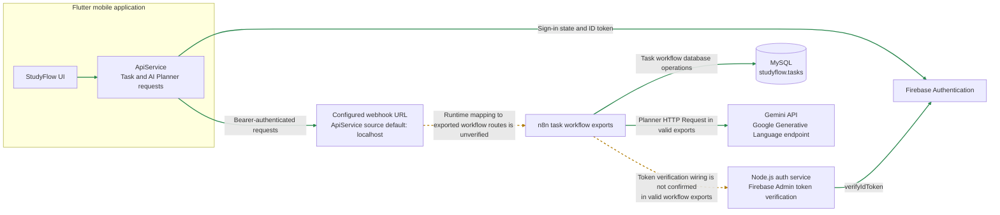
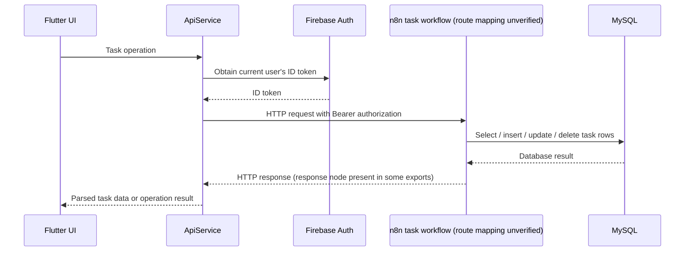
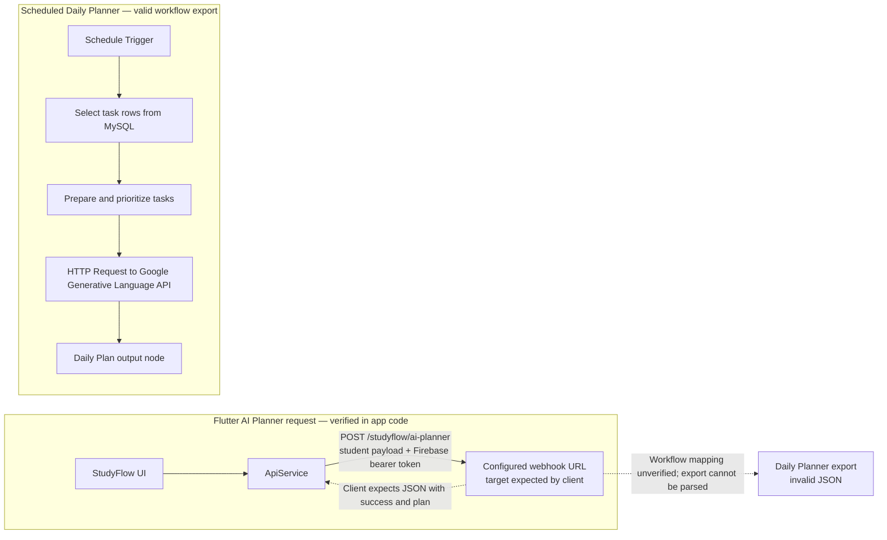

# StudyFlow Architecture

This document describes the architecture visible in the repository. It separates connections directly evidenced by application code or valid workflow exports from connections that remain conceptual or cannot be confirmed from those files.

## System overview

**Legend:** Solid arrows represent connections evidenced by application code or valid workflow exports. Dashed arrows identify mappings that cannot be confirmed from repository files. The configured URL is source configuration; it does not establish that an n8n endpoint is reachable. The diagram does not assert that any workflow is currently active or deployed.

## Request flows

### Task management

The Flutter `ApiService` in `studyflow_mobile/lib/services/api_service.dart` builds authenticated requests to the configured n8n webhook base URL. Its task operations use these paths and methods:

| Operation | Method and path |
| --- | --- |
| Load tasks | `GET /studyflow/tasks` |
| Create task | `POST /studyflow/task` |
| Complete task | `POST /studyflow/task/complete` |
| Edit task | `PUT /77d0d4fa-6d28-47f1-8355-7e092b8af825/studyflow/tasks/{id}` |
| Delete task | `DELETE /67acb603-fddd-43d7-90c7-b41bc8751be2/studyflow/tasks/{id}` |

Requests obtain a Firebase ID token through Firebase Auth and send it in the `Authorization: Bearer …` header. The exports `StudyFlow - Get Tasks.json`, `StudyFlow - Create Task.json`, `StudyFlow - Update Task.json`, `StudyFlow - Complete Task.json`, and `StudyFlow - Delete Task.json` show database operations for task retrieval, creation, update, completion, and deletion. The Get, Create, Update, and Delete exports also show response or subsequent processing nodes; the Complete Task export ends at its MySQL update node. The repository does not prove that each exported workflow is active or that its webhook path is currently paired with the Flutter route.

**Update and delete route mismatch:** The Flutter URLs include UUID path segments before `studyflow/tasks/{id}`. The valid Update and Delete workflow exports define `studyflow/tasks/:id` without those segments. These source paths differ, and the Flutter URLs and exported workflows have not been confirmed as matching runtime endpoints. No route has been changed as part of this documentation.

The sequence summarizes the client contract and the database operations present in task workflow exports; it does not prove these are connected at runtime. In particular, the Update and Delete route strings differ as described above. The Complete Task export has no explicit response node, so its response behavior is also not established by the export.

### AI Planner

The Flutter service sends `POST /studyflow/ai-planner` with a JSON body containing the `student` field, and expects a successful JSON response with `success` and `plan` fields. It uses the same Firebase bearer-token mechanism and applies a 30-second service timeout.

The valid `workflows/StudyFlow - Scheduled Daily Planner.json` export shows a schedule trigger, MySQL task selection, task preparation and prioritization, an HTTP Request node targeting Google's Generative Language API host, and a Daily Plan output node. The separate `workflows/StudyFlow - Daily Planner.json` export is invalid JSON, so it cannot verify how that workflow is triggered or how it connects to the mobile webhook. The scheduled workflow's trigger and the Flutter webhook request are therefore documented as distinct source paths; their runtime relationship is unknown.

## Components

- **Flutter application:** Provides the StudyFlow interface and invokes `ApiService` for task operations and AI Planner generation. `ApiService` obtains the signed-in Firebase user's ID token and attaches it to requests.
- **Firebase Authentication:** Supplies the mobile user's authentication state and ID token. The mobile app initializes Firebase using its platform Firebase options.
- **Node.js auth service:** An Express service in `auth-service/server.js` exposes `/health` and `/verify`. The verify handler extracts a bearer token and calls Firebase Admin `verifyIdToken`; its failure response is generic, and its diagnostic logs only the error code or `unknown`.
- **n8n:** The workflow exports define webhook-triggered task processing and a scheduled planner. Valid task exports connect webhook nodes to MySQL operations. The scheduled planner export connects task selection and preparation to a Google Generative Language API HTTP Request node.
- **MySQL:** `database/schema.sql` defines the `studyflow` database and `tasks` table. Valid task workflow exports contain MySQL nodes for task reads and mutations. The scheduled planner also selects task rows.
- **Gemini:** Valid Create Task and Scheduled Daily Planner workflow exports contain HTTP Request nodes whose URL host is `generativelanguage.googleapis.com`. The repository does not establish active credentials, runtime success, or a deployed Gemini configuration.

## Verification limits

The repository verifies source-level request construction and workflow definitions, not the live environment. In particular, it does not establish:

- Whether the exported n8n workflows are imported, enabled, or currently reachable.
- Whether the mobile AI Planner webhook is connected to the workflow represented by the invalid `StudyFlow - Daily Planner.json` export.
- Whether an n8n workflow calls the Node.js `/verify` endpoint and forwards the original Authorization header. The valid task and scheduled planner exports inspected do not establish that connection.
- Whether MySQL, Firebase Admin, or Gemini credentials are configured correctly at runtime.
- The deployment topology, network names, external URLs, or production hosting arrangement.

The app's source default webhook base URL is `http://localhost:5678/webhook`; this documents a local default only and does not establish a production endpoint.
